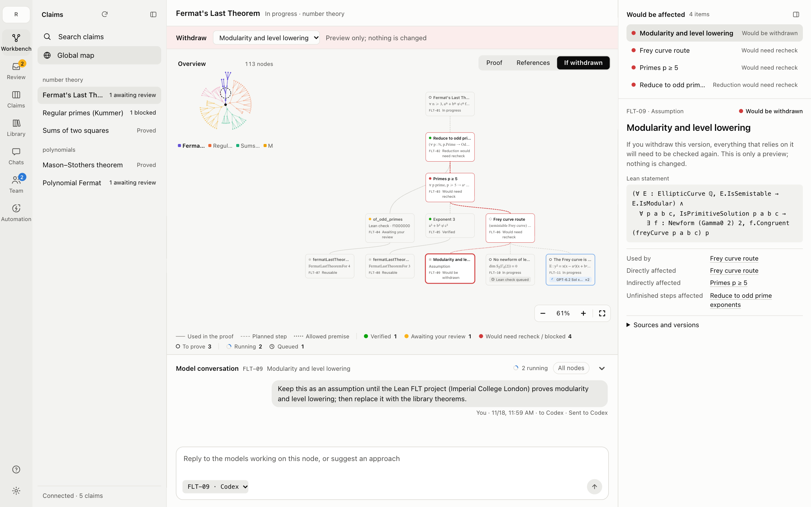

# Trellin

**A local workbench for theoretical research.**

Turn a research question into a precise statement, follow the proof as it develops, and reuse what you have already checked. Trellin keeps the assumptions, proof dependencies, and open decisions in view so you can spend more time on the mathematics.

[Build for macOS](docs/desktop.md#build-for-local-review) · [Browser and CLI](docs/quickstart.md#install) · [Documentation](docs/README.md) · [简体中文](README.zh-CN.md)

<picture>
  <source media="(prefers-color-scheme: dark)" srcset="docs/images/workbench-dark.png">
  
</picture>

*Illustrative Fermat’s Last Theorem workspace. The reduction to odd prime exponents and the cases for exponents 3 and 4 correspond to theorems in the pinned Mathlib. The case for primes at least 5 is open in this example. The proof progress and agent activity shown are sample data.*

## Start here

- **macOS.** Build the [desktop app](docs/desktop.md#build-for-local-review) on an Apple Silicon Mac running macOS 15 or later. After preparing local PostgreSQL with pgvector and Lean, open Trellin and choose a research folder. Trellin creates a workspace inside it and restores your last workspace and selected node when you reopen the app.
- **Browser or terminal.** Install the [Research Multiplier CLI from source](docs/quickstart.md#install). Save a research brief or run a supported offline check with Python alone, or [open the local proof workbench](docs/proof-workbench.md) for a project backed by PostgreSQL.
- **Try a Lean proof.** The [Lean guide](docs/lean-core.md) includes a small example that proves `True → True ∧ True` without a model. It also shows how to [check a `.lean` file or a Lake declaration](docs/lean-core.md#check-a-lean-source-file-or-compiled-declaration) and [replay a verified theorem in another claim](docs/lean-core.md#reuse-a-checked-theorem-in-another-claim).

The macOS app is currently built from source. The Python package and terminal command are both named `research-multiplier`.

## From a question to a reusable result

1. **Confirm the intended statement.** Enter a theorem yourself or use a local model to organize selected notes. Review the exact Lean statement and approve the assumptions and existing results the proof may use. If the meaning changes, review the revised wording and formalization before work continues. [Project intake](docs/project-intake.md)
2. **See where the proof stands.** Open the graph to distinguish verified steps, planned dependencies, and open obligations. Select a node to read its stored Lean statement and see the dependencies recorded by verification. Send a note on that node and follow the task and recorded replies when a model is enabled. [Proof workbench](docs/proof-workbench.md)
3. **Reuse checked results and see the impact of changes.** Within a workspace, Trellin can replay eligible Lean results against the destination’s confirmed basis. Preview which results and obligations would be affected by withdrawing an assumption. If you withdraw a dependency, affected evidence is marked for recheck. [Lean verification and reuse](docs/lean-core.md)

See the assumption withdrawal preview

<picture>
  <source media="(prefers-color-scheme: dark)" srcset="docs/images/withdrawal-dark.png">
  
</picture>

*In the example, withdrawing the modularity and level-lowering assumption affects the Frey curve route and its downstream steps. The preview leaves the workspace unchanged.*

## Keep research on your computer

You choose the project folder. The persistent workflow stores the proof records in that workspace’s PostgreSQL database. Lean verification and supported proof replay run with zero model calls. On-device model suggestions are optional. The workbench’s external Codex workflow requires an explicitly authorized public scope. [Workspace layout](docs/research-foundation.md#workspace-paths) · [Model configuration](docs/model-adapters.md)

[Version history](CHANGELOG.md) · [Contributing](CONTRIBUTING.md) · [Repository layout](docs/engineering.md#repository-layout)

The program and documentation use the [Apache License 2.0](LICENSE). See [NOTICE](NOTICE) and the [name and logo policy](TRADEMARKS.md).
