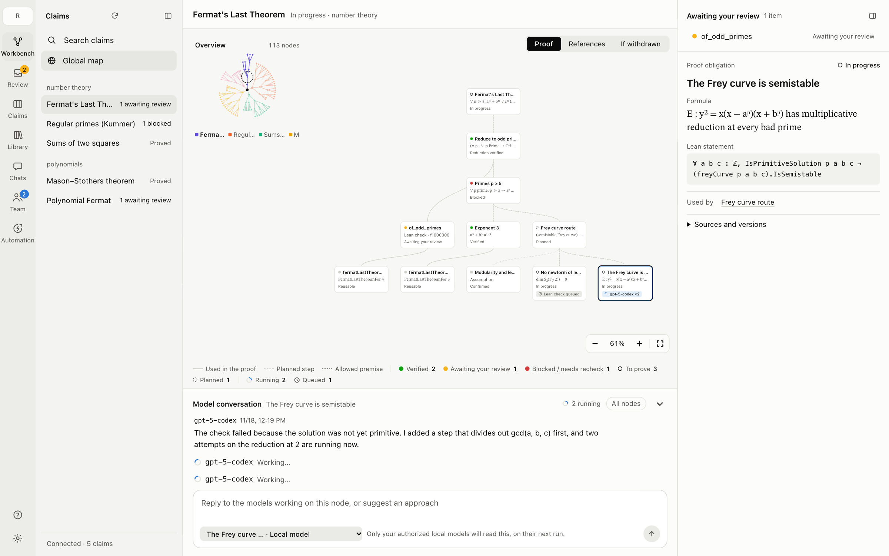

# Research Multiplier

**A research workspace where people and AI models prove theorems together, and every step is checked by Lean.**

English · [简体中文](README.zh-CN.md)

<picture>
  <source media="(prefers-color-scheme: dark)" srcset="docs/images/workbench-dark.png">
  
</picture>

A sample project on Fermat's Last Theorem. The reduction to odd prime exponents and the cases n = 3 and n = 4 are theorems in Mathlib. The general case is open here: its route through the Frey curve rests on the modularity theorem and Ribet's theorem, recorded as an assumption because they are not in Mathlib yet. Sample data; run it yourself with <code>python tests/fixtures/workbench_demo_fermat.py</code>.

## What it does

You decide what to prove and approve exactly what it means. Research Multiplier keeps the proof honest from there.

- **Freeze the exact claim.** Each claim is fixed as a Lean statement together with the assumptions and library theorems you allow. Nothing counts as proved against a statement you did not approve.
- **See the whole proof as a graph.** Goals, reductions, open obligations, assumptions and library theorems, with what is verified, planned, blocked or waiting for your review.
- **Let models do the legwork.** Models propose proofs for open steps in parallel, within a budget you set. You can watch their reasoning and leave notes on any node. Lean checks every result; nothing is accepted on a model's word.
- **Know what depends on what.** Withdraw an assumption and the workbench shows every result that would need to be checked again, before anything changes.
- **Reuse what is already proved.** Verified lemmas and library theorems are recorded with their exact versions and replayed in later claims.

<picture>
  <source media="(prefers-color-scheme: dark)" srcset="docs/images/withdrawal-dark.png">
  
</picture>

"If withdrawn" previews the consequences: here, without modularity and level lowering, the Frey curve route, the case p ≥ 5 and the reduction would all need to be checked again. Nothing is changed until you decide.

## Get started

| If you want to… | Start with… |
| --- | --- |
| Try it with your own question | [Offline quickstart](docs/quickstart.md#start-with-your-own-question). Python 3.10 or later is enough to save a research brief and replay supported checks. |
| Verify your first Lean proof | [First-proof walkthrough](docs/quickstart.md#verify-and-reuse-a-first-lean-proof): confirm a theorem and its assumptions, verify it, reuse it for a second claim, and withdraw it. Uses Lean 4.19.0 and PostgreSQL with pgvector on macOS or glibc Linux. |
| Bring an existing proof | [Check a `.lean` file or Lake declaration](docs/lean-core.md#check-a-lean-source-file-or-compiled-declaration) and see the assumptions and theorems it actually uses. |
| Open the workbench | [Local proof workbench](docs/proof-workbench.md) for a project with a PostgreSQL database: `research-multiplier --workspace PATH workbench`. |

[Full documentation](docs/README.md) · [中文快速入门](docs/quickstart.zh-CN.md)

## How it works

- **Local first.** Each research project lives in its own folder with its own PostgreSQL database. Your inputs, proofs and results stay there; nothing leaves the workspace unless you authorize it. [Workspace layout and backup](docs/research-foundation.md#workspace-paths)
- **Checked, not trusted.** Lean 4 with a pinned Mathlib verifies proofs; deterministic checkers cover selected other domains. Core verification and replay run with zero model calls.
- **Models are optional.** Connect local models, the Codex CLI or API providers, under a monthly project budget you approve. [Model adapters](docs/model-adapters.md)
- **Built to be extended.** Lean is the first plugin; the core is domain-independent, and plugins run as separate processes in any language. [Architecture](docs/architecture.md)

## Project status

Research Multiplier is in active development toward its first public release. The [roadmap](docs/roadmap.md) lists the tasks and their acceptance criteria, and the [changelog](CHANGELOG.md) records what each version adds.

## Contributing

Contributions are welcome. Read the [contributor guide](CONTRIBUTING.md) and [`AGENTS.md`](AGENTS.md); commits are signed off under the Developer Certificate of Origin.

## License

The program and documentation are licensed under the [Apache License 2.0](LICENSE); see [NOTICE](NOTICE). Your research data, proofs and results are yours and are not covered by this license. The project name and logo follow the [name and logo policy](TRADEMARKS.md).
