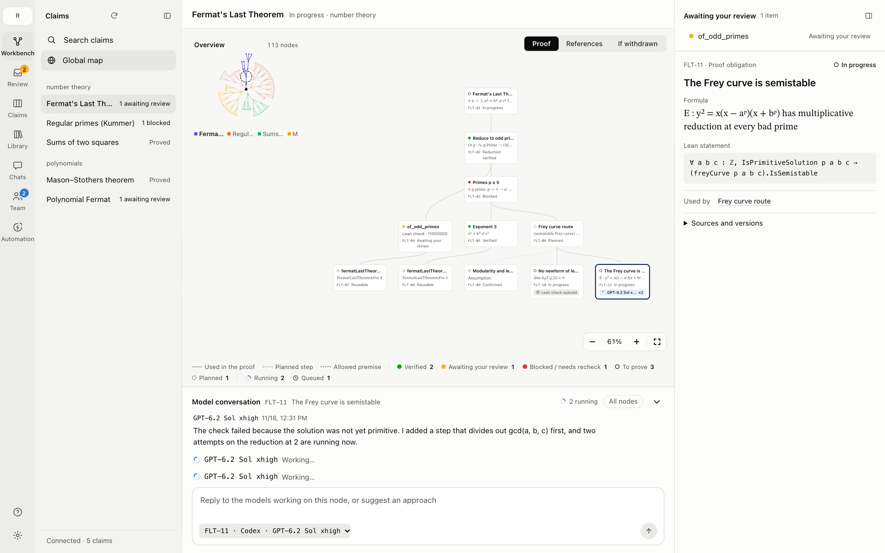
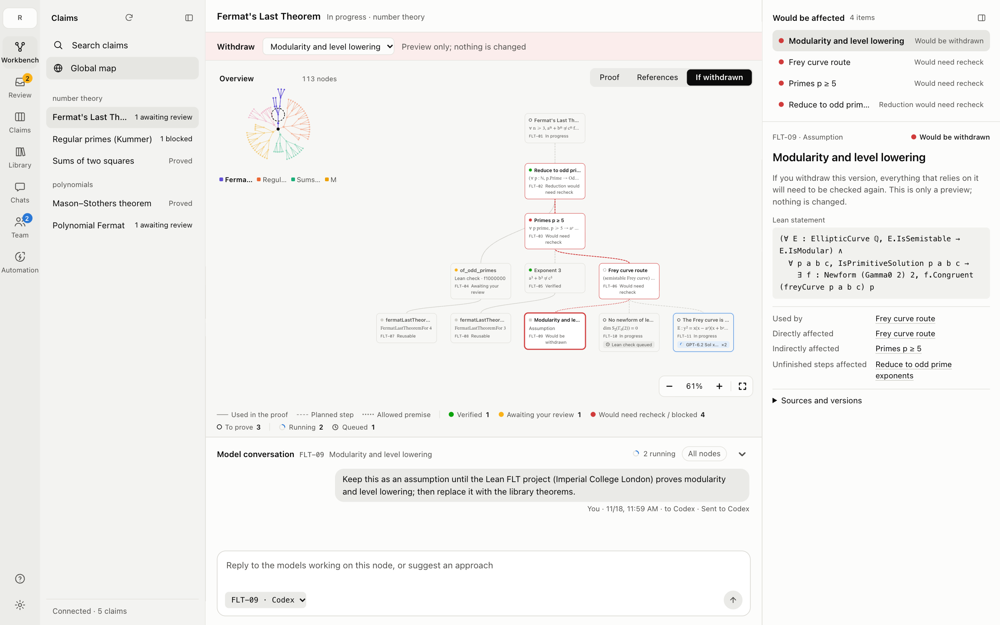

# Trellin

**在本机运行的理论研究工作台。**

把问题写成可核对的命题，跟进证明做到哪里，复用已经核验的结果。Trellin 帮你记住假设、证明依赖和待决事项，让你把时间留给推理和理解。

[构建 macOS 版](docs/desktop.zh-CN.md) · [浏览器和命令行](docs/quickstart.zh-CN.md#安装) · [文档](docs/README.md) · [English](README.md)

<picture>
  <source media="(prefers-color-scheme: dark)" srcset="docs/images/workbench-dark.png">
  
</picture>

*费马大定理示例工作区。归约到奇素数指数以及指数为 3 和 4 的特例，对应固定版本 Mathlib 中的定理。示例中大于等于 5 的素数指数仍待证明。截图中的证明进度和 Agent 活动是演示数据。*

## 开始使用

- **macOS 桌面版。** 在 Apple Silicon、macOS 15 或更新版本上[从源码构建](docs/desktop.zh-CN.md)。准备好本机 PostgreSQL、pgvector 和 Lean 后，打开 Trellin，选择自己的研究目录。应用会在其中创建工作区，重开时恢复上次的课题和所选节点。
- **浏览器或命令行。** [从源码安装](docs/quickstart.zh-CN.md#安装)底层命令行程序。只用 Python 就能保存研究简报或运行支持的离线检查。有 PostgreSQL 的课题可以[打开本地证明工作台](docs/proof-workbench.md)。
- **试一次 Lean 核验。** [Lean 指南](docs/lean-core.md)给出了 `True → True ∧ True` 的小例子，核验时无需调用模型。指南也说明了如何检查已有的 `.lean` 文件或 Lake 声明，并在同一工作区的另一个命题中复用核验结果。

macOS 版目前从源码构建。Python 安装包与命令行都沿用 `research-multiplier`。

## 从研究问题到可复用的结果

1. **确认要证明的命题。** 手动录入定理，或让本地模型协助整理你选中的资料。核对准确的 Lean 陈述，确认允许引用的假设和已有结果。若命题含义发生变化，先核对更新的表述与形式化，再继续工作。[课题开始与定理录入](docs/project-intake.zh-CN.md)
2. **看清证明做到哪一步。** 图谱展示已核验步骤、计划依赖和待证义务。选中节点可以查看保存的 Lean 陈述，以及核验记录中的实际引用。启用模型时，可以在节点上发意见，查看任务进度和已记录的回复。[证明工作台](docs/proof-workbench.md)
3. **复用已核验的结果，预览改动影响。** 同一工作区内，Trellin 可以用目标命题已确认的依据重放适用的 Lean 结果。撤回一个假设之前，先查看哪些结果和待证义务会受影响。实际撤回后，依赖它的证据会标记为待重验。[Lean 核验与复用](docs/lean-core.md)

查看撤回假设的影响预览

<picture>
  <source media="(prefers-color-scheme: dark)" srcset="docs/images/withdrawal-dark.png">
  
</picture>

*在示例中，撤回模性和降级假设会影响 Frey 曲线路线和下游步骤。预览不会改变工作区。*

## 研究资料留在本机

你自己选择项目目录。持久研究的证明记录存放在该工作区的 PostgreSQL 数据库中。Lean 核验和支持的证明重放可以在零模型调用下运行。本地模型可以按需启用。工作台把任务交给外部 Codex 前，需要对相应的公开范围明确授权。[工作区布局](docs/research-foundation.md#workspace-paths) · [模型配置](docs/model-adapters.md)

[版本历史](CHANGELOG.md) · [参与开发](CONTRIBUTING.md) · [仓库结构](docs/engineering.zh-CN.md#仓库结构)

程序与文档采用 [Apache License 2.0](LICENSE)。参见 [NOTICE](NOTICE) 和[名称与标志使用规则](TRADEMARKS.zh-CN.md)。
