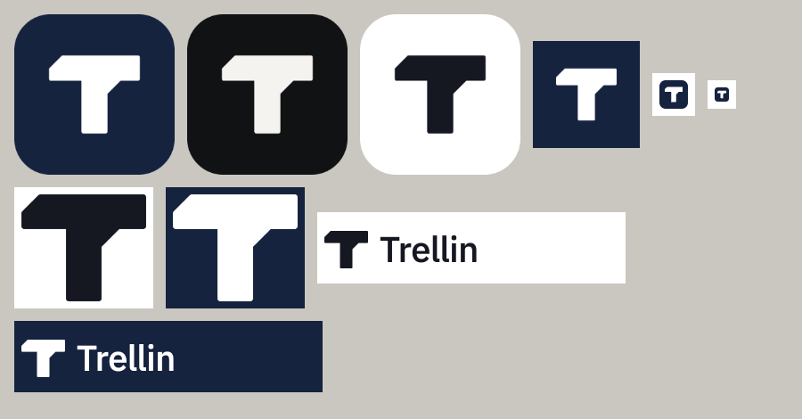

# Trellin logo

English · [简体中文](BRAND.zh-CN.md)

## The mark

A heavy T with two 45° cuts: a step where the stem meets the crossbar, and a matching cut at the crossbar's top-left corner. The two cuts face each other across the letter, like a trellis lath sawn at both ends. The step gives the mark direction and a built, deliberate feel without decoration.

### Construction

The mark sits on a grid of 7 modules wide by 6 modules high.

| Part | Size |
| --- | --- |
| Overall | 7 × 6 modules |
| Crossbar height | 2 modules (drawn 0.06 module thinner, so it looks as heavy as the stem) |
| Stem width | 2 modules |
| Step at the joint | 1 module, at 45° |
| Cut at the top-left | 1 module, at 45° |
| Outer corners | Radius of about 0.16 module; inner corners stay sharp |

In the SVG sources, one module is 7 units, and the mark spans `7.5 11 49 42` in a 64-unit square.

## Colors

| Name | Hex | Use |
| --- | --- | --- |
| Navy | `#16233F` | Primary: app icon, favicon, brand surfaces |
| Ink | `#111214` | Dark surfaces |
| Mark on light | `#151821` | The mark and wordmark on white or light backgrounds |
| Mark on ink | `#F4F3EF` | The mark on ink |
| White | `#FFFFFF` | The mark on navy |

## Wordmark

The mark followed by "Trellin" in IBM Plex Sans Medium, tracking −0.6 at 40 px. The SVG wordmarks keep the text live. Convert it to outlines before print or any use where the font may be missing; the PNG wordmarks are already rendered.

## Clear space and minimum size

- Keep at least 1 module of clear space around the mark, which is one seventh of its width. Around the wordmark, keep the height of the crossbar.
- Smallest sizes: the app icon or favicon at 16 px, the bare mark at 12 px tall, the wordmark at 96 px wide.

## Don't

- Don't redraw, stretch, rotate or slant the mark, and don't round off the two cuts.
- Don't add gradients, shadows or outlines to the mark.
- Don't place the mark on busy images or on colors with low contrast.
- Don't change the wordmark's typeface or spacing.

## Files

| Folder | Contents |
| --- | --- |
| `svg/` | `trellin-mark-{dark,light,navy}.svg`: the mark alone. `trellin-app-icon-{navy,ink,paper}.svg`: rounded app icons. `*-square.svg`: full-bleed versions for stores that apply their own mask. `favicon.svg`. `trellin-wordmark-{dark,light}.svg` |
| `png/` | App icons at 1024, 512, 256, 128 and 64 px, plus full-bleed 1024 px squares. `apple-touch-icon-180.png`. Favicons at 16, 32 and 48 px. Marks at 1024 px wide with transparent backgrounds. Wordmarks at 2× and 4× |

"Dark" files are for light backgrounds, and "light" files are for dark backgrounds.

## Status

Final as of 2026-11-18. The workbench uses `web/src/brand/` (copies of the favicon files) for the browser tab icon. The macOS app icon is drawn from the same geometry in `desktop/macos/packaging/render-icon.swift`, and the app shows it on its welcome and loading screens. The top-left of the workbench rail belongs to the workspace switcher, not the logo.
