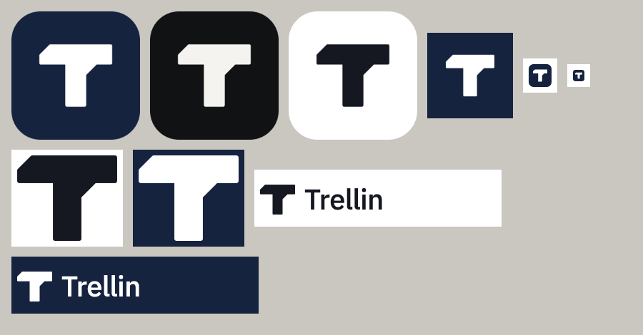

# Trellin 标志

[English](BRAND.md) · 简体中文

## 标志

一个粗重的 T，带两处 45° 斜切：一处是竖笔和横笔相接处的台阶，另一处是横笔左上角对应的斜切。两刀隔着字母遥相呼应，像一根两端都斜着锯开的格架木条。台阶给标志带来方向感，也让它显得经过推敲，而不靠装饰。

### 构造

标志放在宽 7 个模数、高 6 个模数的网格上。

| 部分 | 尺寸 |
| --- | --- |
| 整体 | 7 × 6 个模数 |
| 横笔高度 | 2 个模数（实际画得细 0.06 个模数，这样看上去和竖笔一样粗） |
| 竖笔宽度 | 2 个模数 |
| 接合处的台阶 | 1 个模数，45° |
| 左上角的斜切 | 1 个模数，45° |
| 外角 | 圆角半径约 0.16 个模数；内角保持尖角 |

在 SVG 源文件里，1 个模数等于 7 个单位，标志在 64 单位的正方形中占 `7.5 11 49 42`。

## 颜色

| 名称 | 色值 | 用途 |
| --- | --- | --- |
| 深海军蓝 | `#16233F` | 主色：应用图标、网页图标、品牌底色 |
| 墨黑 | `#111214` | 深色底 |
| 浅底标志色 | `#151821` | 白色或浅色底上的标志和字标 |
| 墨黑底标志色 | `#F4F3EF` | 墨黑底上的标志 |
| 白 | `#FFFFFF` | 海军蓝底上的标志 |

## 字标

标志加上 "Trellin" 字样，字体为 IBM Plex Sans Medium，40 px 时字距为 −0.6。SVG 字标里的文字仍是可编辑的文字；印刷前，或在可能缺少该字体的场合使用前，要先转成轮廓。PNG 字标已经渲染好。

## 留白和最小尺寸

- 标志四周至少留 1 个模数，即标志宽度的七分之一。字标四周至少留一个横笔的高度。
- 最小尺寸：应用图标或网页图标 16 px，单独的标志高 12 px，字标宽 96 px。

## 不要

- 不要重画、拉伸、旋转或倾斜标志，也不要把两处斜切磨圆。
- 不要给标志加渐变、阴影或描边。
- 不要把标志放在杂乱的图片上，或对比度不够的颜色上。
- 不要更换字标的字体或调整字距。

## 文件

| 文件夹 | 内容 |
| --- | --- |
| `svg/` | `trellin-mark-{dark,light,navy}.svg`：单独的标志。`trellin-app-icon-{navy,ink,paper}.svg`：圆角应用图标。`*-square.svg`：满版正方形版本，给会自行加遮罩的应用商店用。`favicon.svg`。`trellin-wordmark-{dark,light}.svg` |
| `png/` | 1024、512、256、128、64 px 的应用图标，以及 1024 px 的满版正方形。`apple-touch-icon-180.png`。16、32、48 px 的网页图标。宽 1024 px 的透明底标志。2 倍和 4 倍的字标 |

文件名里的 "dark" 用于浅色底，"light" 用于深色底。

## 状态

2026-11-18 定稿。工作台使用 `web/src/brand/`（网页图标文件的副本）作为浏览器标签页图标。macOS 应用图标按同一套几何在 `desktop/macos/packaging/render-icon.swift` 中绘制，应用的欢迎页和加载页会显示它。工作台功能栏左上角属于工作区切换器，不放标志。
