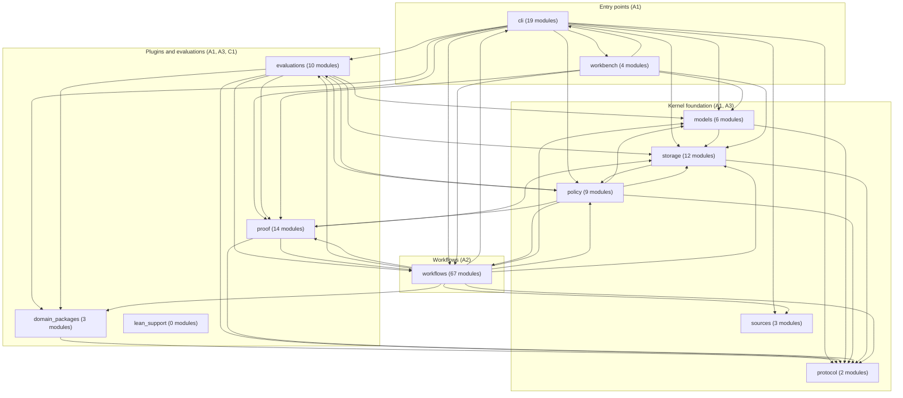

# Package Architecture Map

<!-- Generated by `python scripts/architecture_map.py write`. Do not edit by hand. -->

Generated from static Python imports under `research_multiplier/` (excluding `_compat/`,
`migrations/`, and `_pinned/` byte-frozen sources; pinned alias imports resolve to their
owning subpackage). Regenerate with `python scripts/architecture_map.py write` and verify
with `python scripts/architecture_map.py check` or `python -m pytest -m offline`.

Decisions: **A1** (five-layer structure), **A2** (workflow business logic), **A3** (Lean as plugin).

## Package dependency graph



## Package dependency table

| Package | Layer | Modules | Imports | Imported by |
| --- | --- | ---: | --- | --- |
| `cli` | entry | 19 | `domain_packages`, `evaluations`, `models`, `policy`, `proof`, `protocol`, `sources`, `storage`, `workbench`, `workflows` | `workbench`, `workflows` |
| `domain_packages` | plugin | 3 | `protocol` | `cli`, `evaluations`, `workflows` |
| `evaluations` | plugin | 10 | `domain_packages`, `models`, `policy`, `proof`, `protocol`, `storage`, `workflows` | `cli`, `policy`, `workflows` |
| `lean_support` | plugin | 0 | — | — |
| `models` | kernel | 6 | `protocol`, `storage` | `cli`, `evaluations`, `policy`, `workbench`, `workflows` |
| `policy` | kernel | 9 | `evaluations`, `models`, `proof`, `protocol`, `storage`, `workflows` | `cli`, `evaluations`, `storage`, `workflows` |
| `proof` | plugin | 14 | `protocol`, `storage`, `workflows` | `cli`, `evaluations`, `policy`, `workbench`, `workflows` |
| `protocol` | kernel | 2 | — | `cli`, `domain_packages`, `evaluations`, `models`, `policy`, `proof`, `storage`, `workflows` |
| `sources` | kernel | 3 | — | `cli`, `workflows` |
| `storage` | kernel | 12 | `policy`, `protocol` | `cli`, `evaluations`, `models`, `policy`, `proof`, `workbench`, `workflows` |
| `workbench` | entry | 4 | `cli`, `models`, `proof`, `storage`, `workflows` | `cli` |
| `workflows` | workflows | 67 | `cli`, `domain_packages`, `evaluations`, `models`, `policy`, `proof`, `protocol`, `sources`, `storage` | `cli`, `evaluations`, `policy`, `proof`, `workbench` |

## Enforced layering boundaries

`tests/offline/test_import_boundaries.py` enforces three rules and fails on either a new
forbidden import or a stale allowlist entry (baselines may only shrink):

1. `cli` and `workbench` may import `workflows`, not each other's internals (except the public
   launcher `cli/workbench_cli.py` -> `research_multiplier.workbench.server.serve`).
2. `workflows` must not import `cli` or `workbench`.
3. Kernel packages (`storage`, `policy`, `protocol`, `models`, `sources`, `domain_packages`)
   and non-Lean `workflows` modules must not add new imports of Lean-specific modules (`proof`,
   `lean_support`, or Lean-named modules) or new Lean-named files inside kernel packages.

### Recorded reverse-entry imports (2)

| Source | Target |
| --- | --- |
| `workbench/server.py` | `research_multiplier.cli._output.json_default` |
| `workflows/setup.py` | `research_multiplier.cli.lean_cli._prepare` |

### Recorded kernel-to-Lean imports (17)

| Source | Target |
| --- | --- |
| `policy/scope_review.py` | `research_multiplier.workflows.lean_workflow` |
| `workflows/doctor.py` | `research_multiplier.proof.lean_runner.digest` |
| `workflows/doctor.py` | `research_multiplier.proof.packaged_lean.SETUP_SOURCES` |
| `workflows/intake.py` | `research_multiplier.proof.lean_statement_syntax.require_supported` |
| `workflows/research_followup.py` | `research_multiplier.general_lean` |
| `workflows/research_followup.py` | `research_multiplier.proof.lean_proof_search` |
| `workflows/research_progress.py` | `research_multiplier.evaluations.lean_evolution` |
| `workflows/research_progress.py` | `research_multiplier.storage.lean_progress.PendingLeanPass` |
| `workflows/research_progress.py` | `research_multiplier.storage.lean_progress.hold_lean_pass` |
| `workflows/research_progress.py` | `research_multiplier.storage.lean_progress.pending_lean_passes` |
| `workflows/research_progress.py` | `research_multiplier.workflows.lean_search.search` |
| `workflows/runtime.py` | `research_multiplier.policy.lean_budget.claim` |
| `workflows/setup.py` | `research_multiplier.cli.lean_cli._prepare` |
| `workflows/target_draft.py` | `research_multiplier.lean_parameters.parameters` |
| `workflows/workbench_activity.py` | `research_multiplier.storage.lean_progress.ACTIVE_LEAN_POLICY_SQL` |
| `workflows/workbench_lemma_plans.py` | `research_multiplier.general_lean` |
| `workflows/workbench_lemma_plans.py` | `research_multiplier.workflows.lean_verification` |

### Recorded Lean-named kernel modules (5)

- `policy/lean_budget.py`
- `policy/lean_model_context.py`
- `policy/lean_search_scope.py`
- `sources/formalpedia_lean.py`
- `storage/lean_progress.py`

## Measuring PR change impact radius

Engineering audits (finding `A-202611-05`) measure the change impact radius of a branch or
recent commits directly from this graph:

```sh
python scripts/architecture_map.py impact --git-range origin/main..HEAD
python scripts/architecture_map.py impact --commits 10
python scripts/architecture_map.py impact research_multiplier/storage/paths.py --json
```
